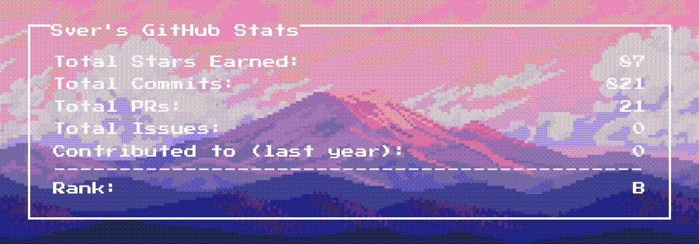

<picture>
  <source media="(prefers-color-scheme: dark)" srcset="https://raw.githubusercontent.com/Sver0411/Sver0411/output/github-stats-crt.png?v=20261121110747">
  <source media="(prefers-color-scheme: light)" srcset="https://raw.githubusercontent.com/Sver0411/Sver0411/output/github-stats.png?v=20261121110747">
  
</picture>

GitHub stats show public activity.

   
  <code>EDGE AI</code>&nbsp;&nbsp;·&nbsp;&nbsp;<code>RESILIENT SYSTEMS</code>&nbsp;&nbsp;·&nbsp;&nbsp;<code>AGENTIC TOOLS</code>
    
  Building reliable edge systems and agentic tools for real-world decisions.
    
  <a href="https://twclab.top">◈ ENTER WEBSITE</a>
  &nbsp;&nbsp;/&nbsp;&nbsp;
  <a href="https://github.com/Sver0411?tab=repositories">◇ OPEN INVENTORY</a>
    

**★ FEATURED FLAGSHIPS (TOP 6 PINNED)**

| Flagship | Highlight | Tech Stack |
| --- | --- | --- |
| [**Smart-Agriculture-Edge-AI**](https://github.com/Sver0411/Smart-Agriculture-Edge-AI) | 7-role, 2-zone edge AI & E220 LoRa system with keyed MAC32 auth, dual-gateway failover and local autonomy | `Python` `C11` `ESP32-S3` `LoRa` |
| [**IoT-MPQUIC-Scheduler**](https://github.com/Sver0411/IoT-MPQUIC-Scheduler) | Deadline- and freshness-aware multipath QUIC (XQUIC) scheduling over dual UDP paths | `C` `Python` `MPQUIC` `Networking` |
| [**AgriTwin-CPS**](https://github.com/Sver0411/AgriTwin-CPS) | Greenhouse digital twin & CPS platform with trust-aware EKF and [**Live 3D WebGL Viewer**](https://sver0411.github.io/AgriTwin-CPS/) | `Python` `TypeScript` `Three.js` `CPS` |
| [**AgriTinyVision**](https://github.com/Sver0411/AgriTinyVision) | MobileNetV2 INT8 crop-leaf anomaly triage on ESP32-S3 N16R8 (ESP-DL) with USB Web console | `PyTorch` `ESP-IDF` `C++` `INT8` |
| [**OpportunityHandbook**](https://github.com/Sver0411/OpportunityHandbook) | Comprehensive decision handbook for university, research, competitions, and career transitions (50+ ★) | `Python` `JavaScript` `Handbook` |
| [**LinguaStep-GradPrep**](https://github.com/Sver0411/LinguaStep-GradPrep) | Local-first bilingual (Japanese + English) JLPT/TOEIC study web app with FSRS-6 & neural TTS | `TypeScript` `Next.js` `FSRS-6` |

**▶ IOT, EMBEDDED & EDGE AI QUESTS**

| Quest | Mission | Stack |
| --- | --- | --- |
| [**TAIS**](https://github.com/Sver0411/TAIS) | Trust-aware sampling, sensor fault diagnosis and selective transmission | `Python` `C11` `Research` |
| [**NetAdapt-IoT**](https://github.com/Sver0411/NetAdapt-IoT) | Multi-flow IoT gateway scheduling balancing Age of Information (AoI), deadlines and fairness | `Python` `ESP32-S3` `PlatformIO` |
| [**EventGuard-LoRa**](https://github.com/Sver0411/EventGuard-LoRa) | Event-aware redundancy tested on ESP32-S3 and E220 Sub-GHz LoRa hardware | `Python` `ESP32-S3` `LoRa` |
| [**AdaptiveSense**](https://github.com/Sver0411/AdaptiveSense) | Change-aware adaptive sampling with two-sided CUSUM slow-drift detection on ESP32-S3 | `Python` `C` `ESP32-S3` |
| [**SensorTrust**](https://github.com/Sver0411/SensorTrust) | Zero-allocation C11 embedded sensor-health monitoring with time-aware slope & CUSUM | `C11` `Python` `IoT` |
| [**TinyEdgeBench**](https://github.com/Sver0411/TinyEdgeBench) | Lightweight TinyML benchmarking (FP32 vs. scalar INT8 vs. ESP-NN SIMD INT8) on ESP32-S3 | `C` `Python` `TinyML` |
| [**EdgeSense-AIoT**](https://github.com/Sver0411/EdgeSense-AIoT) | Cross-channel and cross-node sensor fault vs. environmental event fusion | `C` `Python` `ESP32-S3` |
| [**EdgeFaultLab**](https://github.com/Sver0411/EdgeFaultLab) | Deterministic semantic fault injection proxy for distributed edge/IoT systems | `Python` `Testing` `Reliability` |

**◇ AI AGENTS & WEB WORKBENCHES**

| Project | Focus |
| --- | --- |
| [**OpportunityRadar**](https://github.com/Sver0411/OpportunityRadar) | Finds and verifies timely jobs, research, competitions and open-source opportunities |
| [**OmniTest**](https://github.com/Sver0411/OmniTest) | Pluggable automation testing platform for API, Web and CLI workflows |
| [**ContextGit**](https://github.com/Sver0411/ContextGit) | Versioned context, semantic merging and handoffs for coding agents |
| [**GradJP Skills**](https://github.com/Sver0411/GradJP-Skills) | Evidence-first agent skills for Japanese graduate admissions |
| [**Pocket-Museum**](https://github.com/Sver0411/Pocket-Museum) | Interactive retro handheld museum with realistic system screens and GBA emulation |
| [**ConvertBox**](https://github.com/Sver0411/ConvertBox) | Browser-local image conversion workbench for JPG, PNG and WebP |

  PLAYER SVER0411 · SYSTEMS & AGENT BUILDER · PRESS START TO EXPLORE

